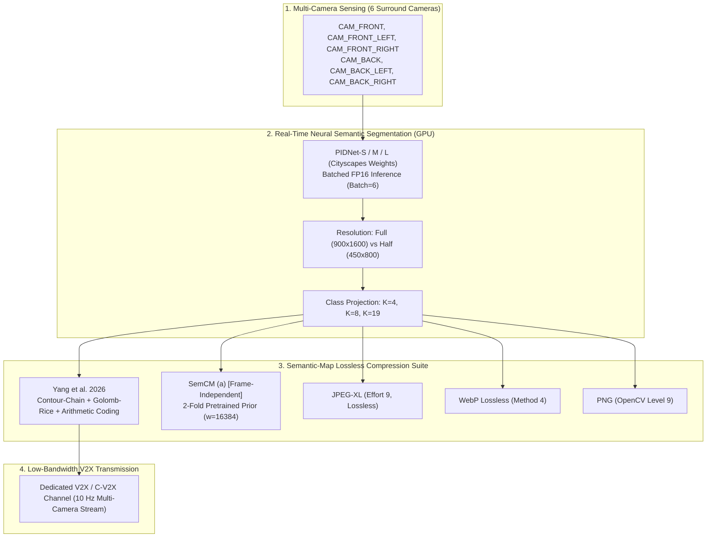

# CARLE V2: Real-Time Multi-Camera Semantic-Map Sharing for V2X Collaborative Perception

[](LICENSE)
[]()
[]()
[]()

This repository contains the official implementation, evaluation suite, and experimental results for **CARLE V2**, an empirical study on **real-time, multi-camera semantic label-map compression for Vehicle-to-Everything (V2X) collaborative autonomous driving**.

---

## 1. Overview & Research Motivation

Connected and Automated Vehicles (CAVs) increasingly rely on **cooperative perception** via V2X networks to see through occlusions and extend sensing ranges beyond direct line-of-sight. However:
1. **Raw Sensor Sharing Bottleneck**: Transmitting raw LiDAR point clouds or multi-camera RGB video consumes tens to hundreds of Megabits per second (Mb/s) per vehicle, far exceeding dedicated V2X radio allocations (e.g., DSRC / C-V2X PC5 channels at 10–20 MHz).
2. **Semantic Abstraction**: Transmitting high-level semantic occupancy and segmentation maps drastically compresses scene information into actionable spatial primitives (roads, dynamic vehicles, pedestrians).
3. **General-Purpose Codec Inefficiency**: Standard lossless codecs (PNG, WebP, JPEG-XL) are designed for natural photographic RGB imagery or generic graphics. They fail to exploit the geometric and topological properties of driving segmentation maps (piecewise-constant regions, smooth contour boundaries, class transitions).

This benchmark establishes rigorous comparisons between state-of-the-art **contour-chain segmentation codecs (Yang et al. 2026, InterDigital)**, **context-adaptive arithmetic range coding (SemCM)**, and standard industry codecs (**JPEG-XL, WebP, PNG**) across **31,822 cached frames** from nuScenes (keyframes & sweeps) and diverse real-world field-test sequences.

---

## 2. System Architecture



---

## 3. Evaluated Datasets & Class Ontologies

### Datasets (All 31,822 Cached Frames)
- **nuScenes Keyframes (2 Hz)**: 2,424 annotated multi-camera keyframe sets.
- **nuScenes Sweeps (12 Hz)**: 6,000 contiguous multi-camera sweep frames across 10 diverse scenes (all 6 cameras, 100 frames/camera).
- **Field-Test Driving Video (Native & 10 Hz)**:
  - *Unflagged Benchmark (3,673 native frames / 1,399 10 Hz frames)*: Bolpur, Malaysia, Sikkim, Dhaka Day, Dhaka Night.
  - *Flagged Domain-Shift (1,811 native frames / 604 10 Hz frames)*: Bhubaneswar Night (isolated due to extreme headlight flare on the ego-vehicle hood).

### Label Granularities ($K$)
- **$K = 4$**:
  1. Road $\{0\}$
  2. Vehicle $\{13, 14, 15, 16\}$ (Car, Truck, Bus, Train)
  3. Vulnerable Road User (VRU) $\{11, 12, 17, 18\}$ (Pedestrian, Rider, Motorcycle, Bicycle)
  4. Other Static $\{1..10\}$ (Sidewalk, Building, Wall, Fence, Pole, Sign, Vegetation, Sky)
- **$K = 8$**:
  1. Road, 2. Sidewalk, 3. Static Structure, 4. Vegetation/Terrain, 5. Sky, 6. Vehicle, 7. Two-Wheeler, 8. Person/Rider
- **$K = 19$**: Full Cityscapes ontology (trainIds $0..18$).

---

## 4. Key Experimental Results

### Table 1: Full-Resolution Codec Master Benchmark ($900\times 1600$)
Measured across all cached frames with 95% bootstrap confidence intervals clustered by scene/clip (1,000 resamples). Bitrates assume a 10 Hz stream transmission rate.

#### Granularity $K = 4$
| Dataset | $N$ Frames | Codec | Bits/Frame | 95% CI Lower | 95% CI Upper | 1-Cam 10 Hz | 6-Cam 10 Hz | Gain vs SemCM (a) |
| :--- | :---: | :--- | :---: | :---: | :---: | :---: | :---: | :---: |
| **nuScenes Keyframes (2 Hz)** | 2,424 | **Yang et al. 2026** | **5,980.1** | 5,408.5 | 6,577.4 | **59.8 kb/s** | **358.8 kb/s** | **+45.97%** |
| | | SemCM (a) [Frame-Indep] | 11,068.4 | 10,124.0 | 11,962.1 | 110.7 kb/s | 664.1 kb/s | 0.00% (Ref) |
| | | JPEG-XL (Effort 9) | 19,608.8 | 18,129.7 | 21,026.4 | 196.1 kb/s | 1,176.5 kb/s | -77.16% |
| | | WebP Lossless | 21,869.3 | 19,912.5 | 23,922.0 | 218.7 kb/s | 1,312.2 kb/s | -97.58% |
| | | PNG (OpenCV level 9) | 49,391.2 | 46,519.1 | 52,311.0 | 493.9 kb/s | 2,963.5 kb/s | -346.23% |
| **nuScenes Sweeps (12 Hz)** | 6,000 | **Yang et al. 2026** | **5,884.5** | 5,265.8 | 6,531.2 | **58.9 kb/s** | **353.1 kb/s** | **+45.94%** |
| | | SemCM (a) [Frame-Indep] | 10,884.4 | 9,856.6 | 11,897.8 | 108.8 kb/s | 653.1 kb/s | 0.00% (Ref) |
| | | JPEG-XL (Effort 9) | 19,405.2 | 17,836.9 | 20,973.4 | 194.1 kb/s | 1,164.3 kb/s | -78.28% |
| | | WebP Lossless | 21,426.9 | 19,165.0 | 23,605.8 | 214.3 kb/s | 1,285.6 kb/s | -96.86% |
| | | PNG (OpenCV level 9) | 48,803.0 | 45,785.2 | 52,098.5 | 488.0 kb/s | 2,928.2 kb/s | -348.38% |
| **Field Native** | 3,673 | **Yang et al. 2026** | **3,289.7** | 1,858.1 | 6,111.9 | **32.9 kb/s** | **197.4 kb/s** | **+44.28%** |
| | | SemCM (a) [Frame-Indep] | 5,904.4 | 3,673.3 | 10,342.8 | 59.0 kb/s | 354.3 kb/s | 0.00% (Ref) |
| | | JPEG-XL (Effort 9) | 9,347.6 | 5,404.5 | 16,967.9 | 93.5 kb/s | 560.9 kb/s | -58.32% |
| | | WebP Lossless | 12,668.3 | 7,210.7 | 22,892.8 | 126.7 kb/s | 760.1 kb/s | -114.56% |
| | | PNG (OpenCV level 9) | 25,483.8 | 16,012.4 | 43,520.5 | 254.8 kb/s | 1,529.0 kb/s | -331.60% |
| **Field 10 Hz** | 1,399 | **Yang et al. 2026** | **3,704.8** | 1,752.1 | 6,233.5 | **37.1 kb/s** | **222.3 kb/s** | **+43.50%** |
| | | SemCM (a) [Frame-Indep] | 6,557.0 | 3,490.8 | 10,617.9 | 65.6 kb/s | 393.4 kb/s | 0.00% (Ref) |
| | | JPEG-XL (Effort 9) | 10,250.7 | 5,302.9 | 17,046.2 | 102.5 kb/s | 615.0 kb/s | -56.33% |
| | | WebP Lossless | 13,874.1 | 7,094.8 | 23,074.8 | 138.7 kb/s | 832.5 kb/s | -111.59% |
| | | PNG (OpenCV level 9) | 27,872.2 | 15,808.8 | 43,776.2 | 278.7 kb/s | 1,672.3 kb/s | -325.09% |

#### Granularity $K = 8$
| Dataset | $N$ Frames | Codec | Bits/Frame | 95% CI Lower | 95% CI Upper | 1-Cam 10 Hz | 6-Cam 10 Hz | Gain vs SemCM (a) |
| :--- | :---: | :--- | :---: | :---: | :---: | :---: | :---: | :---: |
| **nuScenes Keyframes (2 Hz)** | 2,424 | **Yang et al. 2026** | **12,400.1** | 11,466.7 | 13,382.6 | **124.0 kb/s** | **744.0 kb/s** | **+53.64%** |
| | | SemCM (a) [Frame-Indep] | 26,749.9 | 24,675.0 | 28,841.4 | 267.5 kb/s | 1,605.0 kb/s | 0.00% (Ref) |
| | | JPEG-XL (Effort 9) | 35,170.8 | 32,608.2 | 37,564.3 | 351.7 kb/s | 2,110.3 kb/s | -31.48% |
| | | WebP Lossless | 45,336.5 | 42,020.5 | 48,653.6 | 453.4 kb/s | 2,720.2 kb/s | -69.44% |
| | | PNG (OpenCV level 9) | 82,105.4 | 77,357.2 | 86,331.2 | 821.1 kb/s | 4,926.3 kb/s | -206.86% |
| **nuScenes Sweeps (12 Hz)** | 6,000 | **Yang et al. 2026** | **12,175.0** | 11,156.0 | 13,233.1 | **121.8 kb/s** | **730.5 kb/s** | **+53.31%** |
| | | SemCM (a) [Frame-Indep] | 26,078.1 | 23,912.6 | 28,197.2 | 260.8 kb/s | 1,564.7 kb/s | 0.00% (Ref) |
| | | JPEG-XL (Effort 9) | 34,577.6 | 31,881.6 | 37,136.4 | 345.8 kb/s | 2,074.7 kb/s | -32.59% |
| | | WebP Lossless | 44,284.4 | 40,509.4 | 48,030.3 | 442.8 kb/s | 2,657.1 kb/s | -69.81% |
| | | PNG (OpenCV level 9) | 80,571.1 | 75,036.8 | 85,650.2 | 805.7 kb/s | 4,834.3 kb/s | -208.96% |
| **Field Native** | 3,673 | **Yang et al. 2026** | **6,005.0** | 3,916.9 | 9,615.7 | **60.1 kb/s** | **360.3 kb/s** | **+53.55%** |
| | | SemCM (a) [Frame-Indep] | 12,928.1 | 8,809.5 | 20,344.1 | 129.3 kb/s | 775.7 kb/s | 0.00% (Ref) |
| | | JPEG-XL (Effort 9) | 15,970.4 | 10,444.0 | 26,315.1 | 159.7 kb/s | 958.2 kb/s | -23.53% |
| | | WebP Lossless | 23,131.2 | 15,517.2 | 36,708.3 | 231.3 kb/s | 1,387.9 kb/s | -78.92% |
| | | PNG (OpenCV level 9) | 38,502.2 | 25,432.4 | 60,332.1 | 385.0 kb/s | 2,310.1 kb/s | -197.82% |
| **Field 10 Hz** | 1,399 | **Yang et al. 2026** | **6,527.0** | 3,814.4 | 9,772.9 | **65.3 kb/s** | **391.6 kb/s** | **+53.46%** |
| | | SemCM (a) [Frame-Indep] | 14,025.9 | 8,954.2 | 20,687.5 | 140.3 kb/s | 841.6 kb/s | 0.00% (Ref) |
| | | JPEG-XL (Effort 9) | 17,498.0 | 10,470.8 | 26,809.2 | 175.0 kb/s | 1,049.9 kb/s | -24.75% |
| | | WebP Lossless | 25,135.8 | 15,893.1 | 37,348.9 | 251.4 kb/s | 1,508.2 kb/s | -79.21% |
| | | PNG (OpenCV level 9) | 41,761.1 | 26,894.5 | 61,496.1 | 417.6 kb/s | 2,505.7 kb/s | -197.74% |

---

### Table 2: Recommended Operating Point — Half Resolution ($450\times 800$)
At half resolution, neural segmentation latency satisfies real-time V2X requirements while preserving spatial accuracy. Evaluated across all 13,496 unflagged frames with 95% bootstrap CIs.

#### Granularity $K = 4$ ($450\times 800$)
| Dataset | $N$ Frames | Codec | Bits/Frame | 95% CI Lower | 95% CI Upper | 1-Cam 10 Hz | 6-Cam 10 Hz | Gain vs SemCM (a) |
| :--- | :---: | :--- | :---: | :---: | :---: | :---: | :---: | :---: |
| **nuScenes Keyframes (2 Hz)** | 2,424 | **Yang et al. 2026** | **2,607.1** | 2,363.3 | 2,862.7 | **26.1 kb/s** | **156.4 kb/s** | **+42.37%** |
| | | SemCM (a) [Frame-Indep] | 4,524.1 | 4,110.2 | 4,938.1 | 45.2 kb/s | 271.5 kb/s | 0.00% (Ref) |
| | | JPEG-XL (Effort 9) | 6,938.2 | 6,340.5 | 7,523.4 | 69.4 kb/s | 416.3 kb/s | -53.36% |
| | | WebP Lossless | 9,128.7 | 8,321.3 | 9,982.3 | 91.3 kb/s | 547.7 kb/s | -101.78% |
| **nuScenes Sweeps (12 Hz)** | 6,000 | **Yang et al. 2026** | **2,648.7** | 2,399.6 | 2,932.0 | **26.5 kb/s** | **158.9 kb/s** | **+41.84%** |
| | | SemCM (a) [Frame-Indep] | 4,554.1 | 4,184.7 | 4,939.1 | 45.5 kb/s | 273.2 kb/s | 0.00% (Ref) |
| | | JPEG-XL (Effort 9) | 7,030.6 | 6,407.3 | 7,611.9 | 70.3 kb/s | 421.8 kb/s | -54.38% |
| | | WebP Lossless | 9,220.8 | 8,374.5 | 10,053.4 | 92.2 kb/s | 553.3 kb/s | -102.47% |
| **Field Native (25 Hz)** | 3,673 | **Yang et al. 2026** | **2,907.6** | 1,502.6 | 5,579.3 | **29.1 kb/s** | **174.5 kb/s** | **+45.66%** |
| | | SemCM (a) [Frame-Indep] | 5,350.4 | 3,190.7 | 9,717.4 | 53.5 kb/s | 321.0 kb/s | 0.00% (Ref) |
| | | JPEG-XL (Effort 9) | 7,645.8 | 4,688.2 | 13,127.3 | 76.5 kb/s | 458.8 kb/s | -42.90% |
| | | WebP Lossless | 10,933.9 | 6,505.4 | 19,801.4 | 109.3 kb/s | 656.0 kb/s | -104.36% |
| **Field 10 Hz** | 1,399 | **Yang et al. 2026** | **3,276.1** | 1,582.0 | 5,639.3 | **32.8 kb/s** | **196.6 kb/s** | **+44.95%** |
| | | SemCM (a) [Frame-Indep] | 5,951.0 | 3,148.0 | 9,830.1 | 59.5 kb/s | 357.1 kb/s | 0.00% (Ref) |
| | | JPEG-XL (Effort 9) | 8,404.0 | 4,939.4 | 13,011.6 | 84.0 kb/s | 504.2 kb/s | -41.22% |
| | | WebP Lossless | 12,154.4 | 6,403.4 | 20,098.1 | 121.5 kb/s | 729.3 kb/s | -104.24% |

#### Granularity $K = 8$ ($450\times 800$)
| Dataset | $N$ Frames | Codec | Bits/Frame | 95% CI Lower | 95% CI Upper | 1-Cam 10 Hz | 6-Cam 10 Hz | Gain vs SemCM (a) |
| :--- | :---: | :--- | :---: | :---: | :---: | :---: | :---: | :---: |
| **nuScenes Keyframes (2 Hz)** | 2,424 | **Yang et al. 2026** | **5,487.5** | 5,059.2 | 5,935.3 | **54.9 kb/s** | **329.3 kb/s** | **+49.23%** |
| | | SemCM (a) [Frame-Indep] | 10,808.3 | 10,037.3 | 11,622.3 | 108.1 kb/s | 648.5 kb/s | 0.00% (Ref) |
| | | JPEG-XL (Effort 9) | 12,799.0 | 11,858.6 | 13,703.4 | 128.0 kb/s | 767.9 kb/s | -18.42% |
| | | WebP Lossless | 18,979.0 | 17,415.4 | 20,406.9 | 189.8 kb/s | 1,138.7 kb/s | -75.60% |
| **nuScenes Sweeps (12 Hz)** | 6,000 | **Yang et al. 2026** | **5,440.6** | 4,964.1 | 5,927.7 | **54.4 kb/s** | **326.4 kb/s** | **+48.87%** |
| | | SemCM (a) [Frame-Indep] | 10,640.5 | 9,855.6 | 11,487.3 | 106.4 kb/s | 638.4 kb/s | 0.00% (Ref) |
| | | JPEG-XL (Effort 9) | 12,744.4 | 11,833.8 | 13,626.1 | 127.4 kb/s | 764.7 kb/s | -19.77% |
| | | WebP Lossless | 18,759.9 | 17,259.3 | 20,152.8 | 187.6 kb/s | 1,125.6 kb/s | -76.31% |
| **Field Native (25 Hz)** | 3,673 | **Yang et al. 2026** | **4,924.6** | 3,288.9 | 7,572.2 | **49.3 kb/s** | **295.5 kb/s** | **+52.58%** |
| | | SemCM (a) [Frame-Indep] | 10,384.5 | 7,246.4 | 15,356.5 | 103.8 kb/s | 623.1 kb/s | 0.00% (Ref) |
| | | JPEG-XL (Effort 9) | 12,251.9 | 8,661.2 | 17,796.5 | 122.5 kb/s | 735.1 kb/s | -17.98% |
| | | WebP Lossless | 18,253.4 | 12,980.6 | 26,529.3 | 182.5 kb/s | 1,095.2 kb/s | -75.78% |
| **Field 10 Hz** | 1,399 | **Yang et al. 2026** | **5,249.3** | 3,482.3 | 7,569.4 | **52.5 kb/s** | **315.0 kb/s** | **+52.29%** |
| | | SemCM (a) [Frame-Indep] | 11,002.2 | 7,236.7 | 15,373.6 | 110.0 kb/s | 660.1 kb/s | 0.00% (Ref) |
| | | JPEG-XL (Effort 9) | 12,948.6 | 8,724.8 | 17,831.8 | 129.5 kb/s | 776.9 kb/s | -17.69% |
| | | WebP Lossless | 19,248.9 | 12,964.1 | 26,495.7 | 192.5 kb/s | 1,154.9 kb/s | -74.96% |

---

### Table 3: Cool-Machine Timing Verification Pass
Measured on **Intel Core i7-13620H @ 2.40 GHz** and **NVIDIA RTX 3050 Laptop GPU** following a strict cool-machine protocol ($\ge 30\text{ s}$ idle, core temp $< 70^\circ\text{C}$, median of 15 runs).

| Stage | Model / Codec | Resolution | Config | Encode / Batch (ms) | Decode / Frame (ms) | Frame Rate | Temperature (°C) |
| :--- | :--- | :--- | :--- | :---: | :---: | :---: | :---: |
| **Perception** | PIDNet-S | Full ($900\times 1600$) | Batch 1 | 63.86 ms | — | 15.7 FPS | 68.1°C |
| **Perception** | PIDNet-S | Full ($900\times 1600$) | Batch 6 | 333.63 ms total | 55.61 ms/frame | 18.0 FPS | 68.1°C |
| **Perception** | **PIDNet-S** | **Half ($450\times 800$)** | **Batch 1** | **23.74 ms** | — | **42.1 FPS** | **69.1°C** |
| **Perception** | **PIDNet-S** | **Half ($450\times 800$)** | **Batch 6** | **97.13 ms total** | **16.19 ms/frame** | **61.8 FPS** | **69.1°C** |
| **Compression** | Yang et al. 2026 | Full ($900\times 1600$) | $K=4$ | 9.48 ms | 2.87 ms | — | 69.1°C |
| **Compression** | Yang et al. 2026 | Full ($900\times 1600$) | $K=8$ | 14.44 ms | 5.38 ms | — | 69.1°C |
| **Compression** | **Yang et al. 2026** | **Half ($450\times 800$)** | **$K=4$** | **3.03 ms** | **1.07 ms** | — | **69.1°C** |
| **Compression** | **Yang et al. 2026** | **Half ($450\times 800$)** | **$K=8$** | **4.97 ms** | **1.62 ms** | — | **69.1°C** |
| **Compression** | SemCM (a) [Indep] | Half ($450\times 800$) | $K=4$ | 4.96 ms | 63.04 ms | — | 68.1°C |
| **Compression** | SemCM (a) [Indep] | Half ($450\times 800$) | $K=8$ | 4.40 ms | 48.99 ms | — | 69.1°C |
| **Compression** | JPEG-XL (Effort 9) | Half ($450\times 800$) | $K=4$ | 398.53 ms | 20.55 ms | — | 68.1°C |
| **Compression** | WebP Lossless | Half ($450\times 800$) | $K=4$ | 8.12 ms | 2.30 ms | — | 68.1°C |

---

### Table 4: Phase 2 — Slice-Based Coding & MTU Packetization ($450\times 800$)
Independent horizontal slicing ($S \in \{1, 2, 4, 8\}$) evaluated on 4,673 frames per $K$ against a standard 1,200-byte wireless MTU limit.

| $K$ | Slices ($S$) | Mean Frame Bits | Overhead vs $S=1$ (%) | Median Slice Bytes | 99th %ile Slice (B) | Max Slice Bytes | % Slices $\le 1200\text{ B}$ | % Slices $\le 600\text{ B}$ |
| :---: | :---: | :---: | :---: | :---: | :---: | :---: | :---: | :---: |
| **4** | 1 | 2,917.0 | 0.00% | 307.0 B | 1,053.3 B | 1,511 B | 99.79% | 81.51% |
| **4** | 2 | 3,007.7 | +3.11% | 137.0 B | 647.5 B | 1,029 B | **100.00%** | 98.25% |
| **4** | **4** | **3,172.6** | **+8.76%** | **65.0 B** | **423.1 B** | **682 B** | **100.00%** | **99.97%** |
| **4** | 8 | 3,479.9 | +19.30% | 33.0 B | 283.2 B | 504 B | **100.00%** | 100.00% |
| **8** | 1 | 5,214.6 | 0.00% | 640.0 B | 1,372.3 B | 1,876 B | 95.91% | 47.25% |
| **8** | 2 | 5,369.0 | +2.96% | 282.0 B | 899.5 B | 1,264 B | 99.95% | 88.62% |
| **8** | **4** | **5,603.9** | **+7.47%** | **141.0 B** | **628.1 B** | **831 B** | **100.00%** | **98.64%** |
| **8** | 8 | 6,042.9 | +15.88% | 71.0 B | 383.0 B | 644 B | **100.00%** | 99.97% |

---

### Table 5: Phase 3 — Packet Loss & Transmission Resilience (nuScenes 12 Hz)
Simulated over 1,200-byte MTU packets (12-byte header: `frame_id`, `slice_id`, `pkt_idx`, `pkt_count`, `crc32`) across 5 seeds.

| Channel Loss Model | Transmission Scheme | $K=4$ Pixel Acc | $K=4$ mIoU | $K=4$ Mean AoI | $K=8$ Pixel Acc | $K=8$ mIoU | $K=8$ Mean AoI | Effective kb/s ($K=4$ / $K=8$) |
| :--- | :--- | :---: | :---: | :---: | :---: | :---: | :---: | :---: |
| **0% Loss** | Yang Whole-Frame | 100.0% | 100.0% | 83.3 ms | 100.0% | 100.0% | 83.3 ms | 54.6 / 109.8 kb/s |
| | Yang 4-Slices | 100.0% | 100.0% | 83.3 ms | 100.0% | 100.0% | 83.3 ms | 61.5 / 119.3 kb/s |
| | SemCM Persistent ($N=30$) | 100.0% | 100.0% | 83.3 ms | 100.0% | 100.0% | 83.3 ms | 84.5 / 198.5 kb/s |
| | Compact Temporal | 100.0% | 100.0% | 83.3 ms | 100.0% | 100.0% | 83.3 ms | 84.5 / 198.5 kb/s |
| **10% Bernoulli** | **Yang 4-Slices** | **99.59%** | **97.62%** | **83.3 ms** | **99.16%** | **97.10%** | **83.3 ms** | 61.5 / 119.3 kb/s |
| | **Yang 8-Slices** | **99.54%** | **97.09%** | **83.3 ms** | **99.09%** | **96.58%** | **83.3 ms** | 70.5 / 130.8 kb/s |
| | Yang Whole-Frame | 99.54% | 97.72% | 90.8 ms | 98.71% | 96.09% | 99.8 ms | 54.6 / 109.8 kb/s |
| | SemCM Persistent ($N=30$) | 90.07% | 65.13% | 856.2 ms | 86.42% | 58.74% | 884.2 ms | 84.5 / 198.5 kb/s |
| | Compact Temporal | 80.22% | 44.18% | 4,015.5 ms | 78.49% | 40.56% | 3,822.4 ms | 84.5 / 198.5 kb/s |
| **Burst 2 ($L_B=5, P_L=10\%$)** | **Yang 8-Slices** | **99.56%** | **97.53%** | **84.5 ms** | **99.13%** | **96.88%** | **84.5 ms** | 70.5 / 130.8 kb/s |
| | **Yang 4-Slices** | **99.53%** | **97.37%** | **89.3 ms** | **99.06%** | **96.48%** | **92.3 ms** | 61.5 / 119.3 kb/s |
| | Yang Whole-Frame | 99.30% | 97.11% | 106.7 ms | 98.49% | 95.38% | 134.5 ms | 54.6 / 109.8 kb/s |
| | SemCM Persistent ($N=30$) | 96.67% | 89.11% | 298.2 ms | 93.63% | 83.25% | 647.8 ms | 84.5 / 198.5 kb/s |
| | Compact Temporal | 89.81% | 71.16% | 1,656.5 ms | 85.34% | 64.91% | 2,534.8 ms | 84.5 / 198.5 kb/s |

---

### Table 2: Edge Hardware Latency & Multi-Camera Throughput
Evaluated on **Intel Core i7-13620H** and **NVIDIA GeForce RTX 3050 6GB Laptop GPU** (FP16 mode):

| Stage | Model / Codec | Resolution | Batch Size | Latency | Throughput | 10 Hz Real-Time Feasibility |
| :--- | :--- | :---: | :---: | :---: | :---: | :---: |
| **Segmentation** | PIDNet-S | Full ($900 \times 1600$) | 1 | 59.57 ms | 16.8 FPS | Single-camera only |
| **Segmentation** | PIDNet-S | Full ($900 \times 1600$) | 6 | 311.26 ms total | 19.3 FPS | Exceeds 100 ms 6-cam budget |
| **Segmentation** | **PIDNet-S** | **Half ($450 \times 800$)** | **6** | **90.99 ms total** | **65.9 FPS** | **$\le 100\text{ ms}$ (All 6 cameras real-time)** |
| **Segmentation** | PIDNet-M | Half ($450 \times 800$) | 6 | 228.03 ms total | 26.3 FPS | Exceeds 100 ms budget |
| **Segmentation** | PIDNet-L | Half ($450 \times 800$) | 6 | 320.85 ms total | 18.7 FPS | Exceeds 100 ms budget |
| **Compression** | **Yang et al. 2026** | Full ($K=4$) | 1 (1 core) | **7.11 ms** | **140.6 FPS** | **$\le 10\text{ ms}$ per camera** |
| **Compression** | **Yang et al. 2026** | Full ($K=8$) | 1 (1 core) | **9.31 ms** | **107.4 FPS** | **$\le 10\text{ ms}$ per camera** |
| **Decompression** | **Yang et al. 2026** | Full ($K=4$) | 1 (1 core) | **2.10 ms** | **476.2 FPS** | Ultra-fast receiver decode |
| **Decompression** | **Yang et al. 2026** | Full ($K=8$) | 1 (1 core) | **3.04 ms** | **328.9 FPS** | Ultra-fast receiver decode |

---

## 5. Repository Structure

```text
CARLE V2/
├── baselines/
│   └── yang2026/                       # Yang et al. 2026 (InterDigital)
│       ├── source/                     # Production C++ source
│       ├── source_instrumented/        # Instrumented build with std::chrono & dead-code counters
│       ├── Makefile, CMakeLists.txt
│       └── README.md
├── carle/
│   ├── env.py                          # Environment detection
│   └── rigorous_codecs.py              # SemCM Numba range coder & context utilities
├── configs/
│   └── fieldtest.yaml                  # Field video parameters & ground truth metadata
├── experiments/
│   ├── p0_verify_yang.py               # Phase 0: 31,822 frame lossless round-trip proof
│   ├── prepare_instrumented_yang.py    # Generates instrumented source
│   ├── run_p0_dead_code_sample.py      # Stratified 600-frame counter & timing verification
│   ├── exp_11_pidnet_caching.py        # PIDNet segmentation caching
│   ├── exp_14_unified_freeze_benchmark.py # Unified 2-fold freeze runner
│   ├── exp_16_pidnet_sweep.py          # Latency, FPS, granularity & flicker study
│   ├── exp_16_run_all_frames_p1.py     # Master all-frame benchmark runner (Full Res)
│   ├── exp_17_cache_pidnet_half.py     # Phase 1b: Half-resolution map caching
│   ├── exp_18_cool_timing_pass.py      # Strict cool-machine timing verification pass
│   ├── exp_19_p1b_all_frames.py        # Phase 1b: All-frame benchmark at 450x800
│   ├── exp_20_p2_slices.py             # Phase 2: Slice-based coding benchmark
│   ├── exp_21_p3_packet_loss.py        # Phase 3: Packet loss resilience & transmission simulation
│   └── fast_pretrain.py                # Accelerated Numba JIT 2-fold model pretrainer
├── results/
│   ├── phase0/
│   │   └── env.json                    # Hardware identity (i7-13620H, RTX 3050 Laptop)
│   ├── phase1/                         # Summary tables & benchmark CSVs (Full & Half Res)
│   │   ├── cool_timing_summary.csv     # Verified cool-machine timing table
│   │   ├── p1b_master_summary_k4.csv   # Half-resolution master summary table (K=4)
│   │   ├── p1b_master_summary_k8.csv   # Half-resolution master summary table (K=8)
│   │   ├── p1b_flagged_summary_k4.csv  # Half-resolution flagged Bhubaneswar summary (K=4)
│   │   └── p1b_flagged_summary_k8.csv  # Half-resolution flagged Bhubaneswar summary (K=8)
│   ├── phase2/
│   │   ├── p2_slice_benchmark.csv      # Slice overhead and payload distribution table
│   │   └── p2_slice_distribution.json  # Detailed quantile and MTU statistics
│   └── phase3/
│       └── p3_packet_loss_summary.csv  # Resilience benchmark across channels and schemes
└── README.md
```

---

## 6. Reproduction Guide

### Prerequisites
- Python $\ge$ 3.10 (tested on 3.12)
- MinGW-w64 GCC or Linux GCC supporting C++17
- NVIDIA GPU with CUDA 12.x and PyTorch with FP16 support

### 1. Compile the Yang et al. 2026 Codec
```bash
cd baselines/yang2026
make
# Or with MinGW GCC:
g++ -std=c++17 -O3 -static source/commonlib/*.cpp source/arithmetic_coder/*.cpp source/arithmetic_coder/third_party/*.cpp source/encoder/*.cpp -I source/commonlib -I source/arithmetic_coder -I source/arithmetic_coder/third_party -I source/encoder -o encoder.exe
g++ -std=c++17 -O3 -static source/commonlib/*.cpp source/arithmetic_coder/*.cpp source/arithmetic_coder/third_party/*.cpp source/decoder/*.cpp -I source/commonlib -I source/arithmetic_coder -I source/arithmetic_coder/third_party -I source/decoder -o decoder.exe
```

### 2. Verify Lossless Reconstruction & Dead-Code Counters (Phase 0)
```bash
python experiments/run_p0_dead_code_sample.py
```

### 3. Run Cool-Machine Timing Verification Pass
```bash
python experiments/exp_18_cool_timing_pass.py
```

### 4. Run Half-Resolution Master All-Frame Benchmark (Phase 1b)
```bash
python experiments/exp_17_cache_pidnet_half.py
python experiments/exp_19_p1b_all_frames.py
```

### 5. Run Slice-Based Coding Benchmark (Phase 2)
```bash
python experiments/exp_20_p2_slices.py
```

### 6. Run Packet Loss & Resilience Simulation (Phase 3)
```bash
python experiments/exp_21_p3_packet_loss.py
```

---

## 7. Citation & References

```bibtex
@article{yang2026lossless,
  title={Lossless Segmentation-Map Compression via Contour-Chain Coding and Context-Adaptive Golomb-Rice Arithmetic Models},
  author={Yang, et al.},
  journal={arXiv preprint arXiv:2603.03073},
  year={2026}
}

@inproceedings{xu2023pidnet,
  title={PIDNet: A Real-time Semantic Segmentation Network Inspired by PID Controllers},
  author={Xu, Jiacong and Xiong, Zixiang and Bhattacharyya, Saurabh P.},
  booktitle={CVPR},
  year={2023}
}
```
